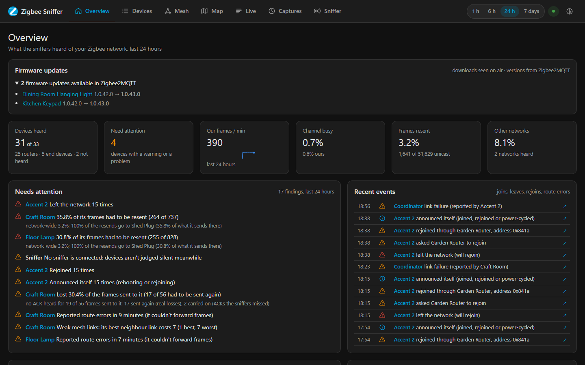
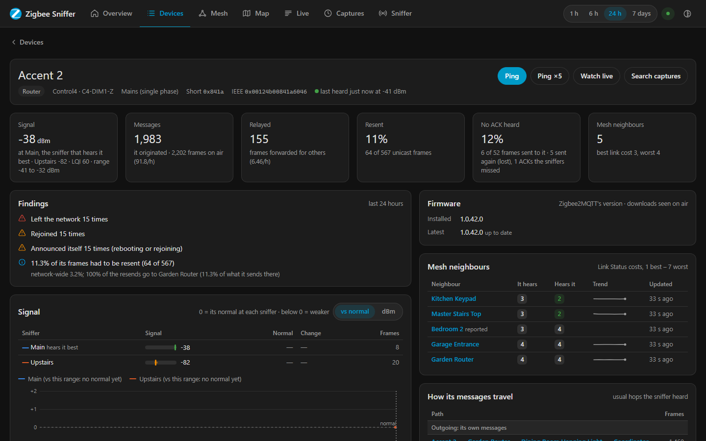
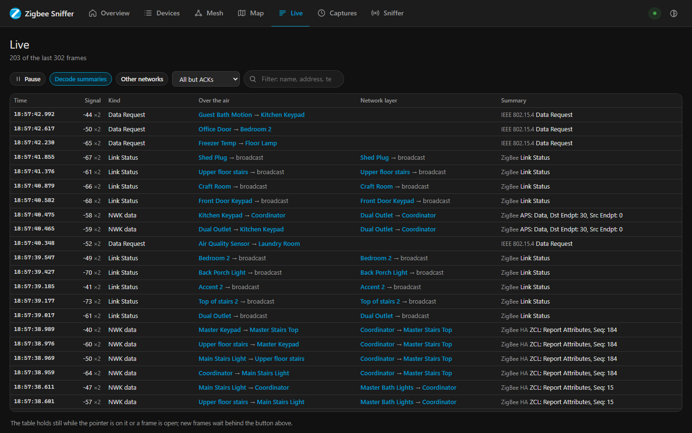
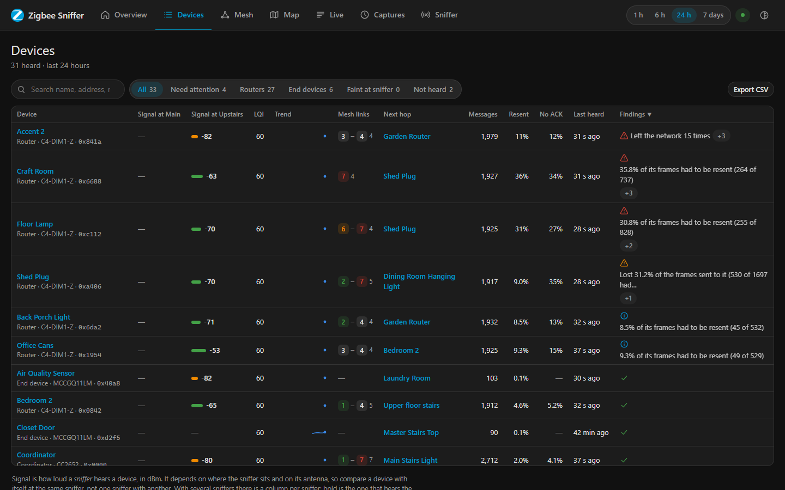
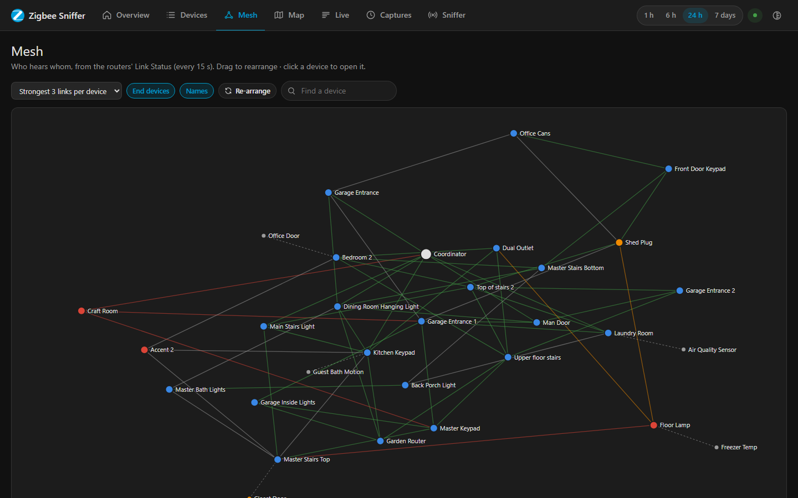

# Zigbee Sniffer

**Find out what's really going on in your Zigbee network.**

Why did that light take three seconds to respond? Which device keeps dropping off? Is the
neighbour's network crowding yours? Zigbee Sniffer answers questions like these by *listening*. Put
one or more small ESP32 radios around your home and it hears every message your devices send, then
turns that into plain answers in Home Assistant.

It only listens. It never transmits, so it can't disturb your network.

## What it tells you

- **Which devices need attention, and why**: messages that had to be resent, devices that keep
  rejoining, routes that break, weak links, devices that went quiet.
- **Signal history for every device**, at every sniffer, so you can see when something got worse.
- **How messages travel** through your mesh: who relays for whom, and which links are lopsided.
- **A live view** of what's on the air, fully decoded, and hourly captures you can open in
  Wireshark.
- **A map** of who hears whom, and floor plans with an estimate of your Zigbee coverage.
- **Home Assistant sensors** for sniffer status and each device's health, so you can automate on them.

| A device's story | Live, decoded |
| --- | --- |
|  |  |

| Every device | The mesh |
| --- | --- |
|  |  |

## What you need

- Home Assistant OS or Supervised, with **Zigbee2MQTT** (it reads device names from it)
- At least one sniffer. Either:
  - **On Wi-Fi:** a Seeed **XIAO ESP32C6** (the radio) wired to an **ESP32-S3** board (the Wi-Fi
    bridge), powered from any USB charger, or
  - **On USB:** a Seeed **XIAO ESP32C5** plugged straight into your Home Assistant machine

More sniffers in different rooms hear more of your home. The firmware for both is in
[`firmware/`](firmware/), with wiring and flashing steps.

## Install

1. **Build a sniffer** and flash it: see [`firmware/README.md`](firmware/README.md).
2. **Add the add-on:** click the **Add repository** button at the top of this page (or add
   `https://github.com/home-controls/zigbee-sniffer` under *Settings → Add-ons → Add-on store → ⋮ →
   Repositories*), then install **Zigbee Sniffer**.
3. **Tell it where your sniffer is:** on the add-on's **Configuration** tab, enter your Wi-Fi
   sniffer's IP address (or add your USB sniffer), set your Zigbee channel, and start it.

Findings start right away. Give it about 12 hours to learn each device's normal signal, so it can
also tell you when one gets weaker than usual.

## Questions

**Can it break my network?** No. The radios only receive.

**Does it need my network key?** It reads the key from Zigbee2MQTT on your own machine so it can
decode messages. The key never leaves your Home Assistant.

**How many sniffers do I need?** One is enough to start. Each one only hears its corner of the home,
so add more where devices give you trouble.

**Where's the full guide?** In [the add-on's documentation](zigbee_sniffer/DOCS.md), which Home
Assistant also shows on the add-on's page.

## The Zigbee family

Zigbee Sniffer is one of three apps that share one look:

| | |
| --- | --- |
| [Zigbee Studio](https://github.com/home-controls/zigbee-studio) | A fast page for Zigbee2MQTT; shows the Sniffer's findings next to each device |
| **Zigbee Sniffer** | This one: listen to your network |
| [Zigbee Bridge](https://github.com/home-controls/zigbee-bridge) | Put your Zigbee coordinator on Ethernet, wherever reception is best |

## For developers

How it works inside (the protocol, merging several sniffers, the coverage model, the API), and how
to run it against simulated sniffers: [`zigbee_sniffer/README.md`](zigbee_sniffer/README.md) and
[`zigbee_sniffer/dev/README.md`](zigbee_sniffer/dev/README.md). The shared look comes from
[zigbee-ui](https://github.com/home-controls/zigbee-ui).

## License

MIT, see [LICENSE](LICENSE). Zigbee and the Zigbee logo are trademarks of the Connectivity Standards
Alliance; this project is not affiliated with or endorsed by it.
